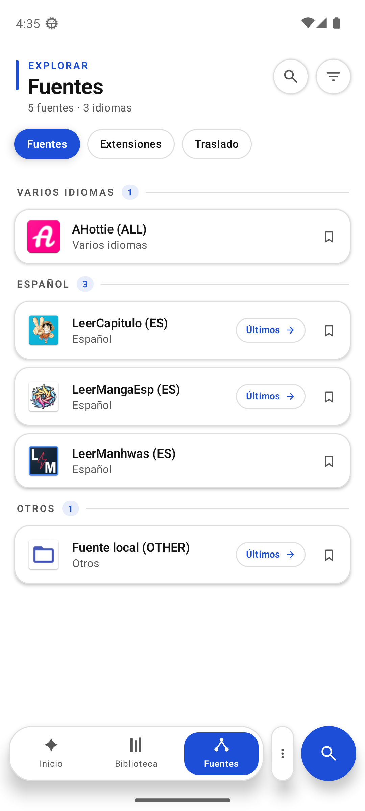
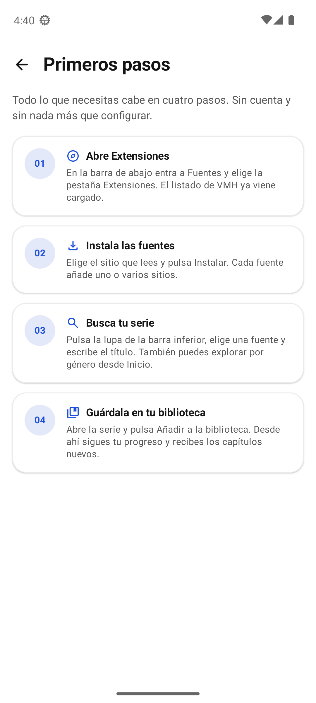
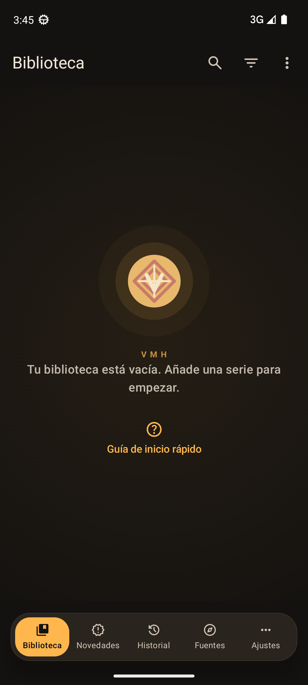

<div align="center">


# VMH

### Your manga, your sources, your progress.

Manga, manhwa and webtoon reader for Android. No account, no ads, no clutter:
just the sites you already read, one library and one place to pick up where you left off.

[](/LICENSE)
[](#download)
[](https://github.com/vmh-app/vmh/releases/latest)

</div>

## Download

Grab the latest APK from [Releases](https://github.com/vmh-app/vmh/releases/latest).
Android 8.0 or newer. No Play Store, no sign-in.

## What's inside

| | |
|---|---|
| **Sources in one list** | Extensions in the Tachiyomi / Mihon format work as-is: the extension store is already added the first time you open the app. |
| **Library that keeps up** | Reading progress, tracking, history and categories, with a daily update you schedule yourself. |
| **Reader built for long sessions** | Five reading modes, vertical slider, incognito mode when you want it out of your history. |
| **Private by default** | Local library, no account, no ad SDK. Backups are yours: on-device or to your own cloud. |
| **Speaks your language** | English base with 15 full translations, Spanish included. |

## Screenshots

<div align="center">


&nbsp;&nbsp;

&nbsp;&nbsp;


</div>

## Getting started

1. Open **Sources** and pick the site you read from the extension list.
2. Install it, then search for a series by title.
3. Add the series to your library and read.

The app walks you through these four steps the first time it opens.

## Extensions

VMH installs the same extension APKs that Tachiyomi and Mihon use, so any repository
built for them is valid here. Extensions signed by the community repositories or by
VMH are trusted without extra steps.

## Build

```bash
./gradlew assembleDebug
```

Requires JDK 21 and the Android SDK. Release builds are signed with the VMH keystore;
the signing configuration is read from `keystore.properties`, which is never committed.

## Credits

VMH is a fork of [Mihon](https://github.com/mihonapp/mihon), which in turn descends from
[Tachiyomi](https://github.com/tachiyomiorg). Both are licensed under the
[GNU General Public License v3.0](/LICENSE); this project keeps the same license and the
same upstream history.

VMH does not host or distribute any content. It only displays what its sources return.
